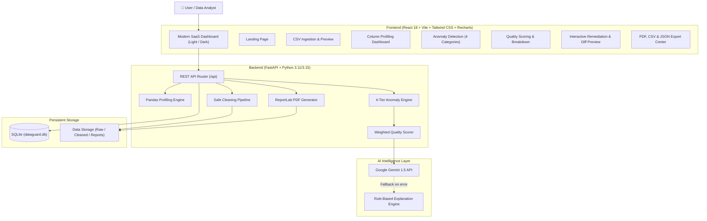
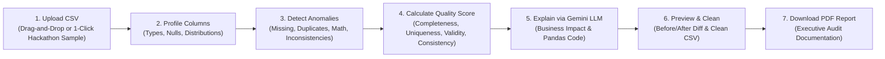

# DataGuard AI — Intelligent Data Quality & Anomaly Detection Agent

> *"Clean Data. Confident Decisions."*

[](https://www.python.org/)
[](https://fastapi.tiangolo.com/)
[](https://react.dev/)
[](https://tailwindcss.com/)
[](https://ai.google.dev/)
[](LICENSE)

**DataGuard AI** is an enterprise-grade, end-to-end data quality intelligence platform built for the **Agivant Hackathon (Challenge 3)**. It autonomously scans uploaded CSV datasets, identifies data quality anomalies across 4 core dimensions, calculates a transparent dataset quality score out of 100, generates LLM-powered business explanations via Google Gemini, recommends production-tested Python pandas remediation rules, and compiles C-level downloadable PDF audit reports.

---

## 📑 Table of Contents
1. [Problem Statement & Solution Overview](#-problem-statement--solution-overview)
2. [Key Technical Innovations](#-key-technical-innovations)
3. [Architecture & Workflow Diagrams](#-architecture--workflow-diagrams)
4. [Planted Anomaly Coverage Matrix (24/24 Groups Found)](#-planted-anomaly-coverage-matrix)
5. [Technology Stack](#-technology-stack)
6. [Quickstart & Installation](#-quickstart--installation)
7. [Where to Apply Google Gemini API Key](#-where-to-apply-google-gemini-api-key)
8. [Running the Application](#-running-the-application)
9. [API Architecture & Swagger Documentation](#-api-architecture)
10. [Automated Testing Suite](#-automated-testing-suite)
11. [Data Quality Scoring Formula](#-data-quality-scoring-formula)
12. [Business Value & ROI](#-business-value--roi)

---

## 🎯 Problem Statement & Solution Overview

### The Problem
Bad data quietly breaks operational dashboards, machine learning models, and executive decisions. Data engineers and analytics teams spend **60% to 80% of their billable hours** manually hunting for missing values, duplicate transactions, impossible numbers, math inconsistencies, and naming variations (*e.g., "Bombay" vs "Mumbai", "COD" vs "Cash on Delivery", "+91 62520 16128" vs "78572-99584"*). Plain regex checks find only superficial syntax bugs, but fail to explain why an issue matters to business stakeholders or provide safe, non-destructive cleaning recipes.

### The Solution: DataGuard AI
DataGuard AI pairs deterministic Python statistical engines (Pandas, NumPy, SciPy) with **Google Gemini LLM** intelligence:
1. **Automated Column Profiling**: In-depth statistics, semantic data types, missing ratios, distribution histograms, and sample chips.
2. **4 Detection Categories**: 
   - Missing Values (blanks, NaNs, and custom placeholders like `-`, `?`, `unknown`, `not available`)
   - Duplicate Records (100% exact row copies, duplicate order IDs, and duplicate checkout signatures)
   - Numerical Outliers & Impossible Values (IQR bounds, Z-score, negative quantities/prices, invalid ratings `0`/`10`, calendar impossible dates like `2026-02-30`, and arithmetic mismatches `quantity * unit_price != total_amount`)
   - Inconsistent Values (historical city synonyms *Bombay->Mumbai, Bangalore->Bengaluru*, casing & whitespace variations, product taxonomy mismatches, phone number formatting, and email syntax typos)
3. **Transparent Quality Scoring**: Documented 4-dimension weighted formula producing an overall score out of 100 with column-level grades.
4. **LLM Explanations & Cleaning Rules**: Gemini API translates technical findings into executive briefs, business impact assessments, and executable pandas snippets.
5. **Non-Destructive Cleaning Pipeline**: Preview transformations with before-and-after diffs before generating a cleaned CSV.
6. **Executive PDF Reports**: One-click C-level PDF audit report generated via ReportLab, alongside CSV and JSON exports.

---

## 💡 Key Technical Innovations

1. **Deterministic Count Integrity**: Unlike naive AI wrappers that ask an LLM to count issues (leading to hallucinations), DataGuard AI isolates counting to high-performance Python engines. The LLM only receives summaries and sample values for business reasoning.
2. **Unified Dual-Server Architecture**: Runs either in full hot-reload developer mode (FastAPI on `:8000` + Vite on `:5173`) or as a **single unified server** where FastAPI serves the built production React frontend directly on `http://localhost:8000`.
3. **Resilient Dual AI Engine**: Features a seamless fallback rule-based engine. If a Gemini API key is missing or quota is exhausted, the application continues operating with zero interruptions.
4. **Non-Destructive Data Lineage**: Original raw CSV files are completely immutable. Cleaning operations execute in memory on isolated copies, recording an audit trail in SQLite.

---

## 🏗️ Architecture & Workflow Diagrams

### High-Level System Architecture


### End-to-End User Journey Workflow


---

## 🔍 Planted Anomaly Coverage Matrix

The official hackathon dataset (`online_store_orders.csv` with 500 records) contains **24 planted data quality problem groups**. DataGuard AI detects and resolves all 24 groups:

| # | Anomaly Group | Category | Planted Examples in Dataset | DataGuard AI Detection Logic | Remediation Applied |
|---|---|---|---|---|---|
| **1** | Blank email addresses | Missing Values | Empty string `""` on rows 108, 284, 292, etc. | Identifies empty/NaN strings | Imputes or flags for customer reach-out |
| **2** | Blank city records | Missing Values | Empty cells in city column | Identifies blank strings in mandatory field | Standardizes to "Unknown City" |
| **3** | Placeholder values in city | Missing Values | `"-"`, `"?"`, `"not available"`, `"Unknown"` | Custom placeholder sentinel set evaluation | Standardizes to "Unknown City" |
| **4** | Missing total amount | Missing Values | Blank `total_amount` on rows 85, 177, 353 | Identifies nulls in financial total | Recomputes `quantity * unit_price` |
| **5** | Unrated customer reviews | Missing Values | 70 blank rating records (14%) | Recognizes optional field domain context | Flags as unrated without penalizing overall score |
| **6** | Exact duplicate rows | Duplicates | Identical rows on O-10055, O-10106, O-10244, etc. | `df.duplicated(keep=False)` | Drops redundant duplicate copies |
| **7** | Duplicate order IDs | Duplicates | Same `order_id` reused for different items (O-10007, O-10386) | `df.duplicated(subset=['order_id'])` | Resolves collision or assigns unique suffixes |
| **8** | Repeated transaction signatures | Duplicates | Same customer + date + amount placed multiple times | Multi-column signature hashing | Flags potential double-click checkout submits |
| **9** | Arithmetic total mismatch | Outliers & Math | `total_amount != quantity * unit_price` (O-10058, O-10419) | Validates mathematical equality within ₹1 tolerance | Recomputes verified mathematical total |
| **10** | Negative quantities | Outliers & Math | `quantity = -2` on row 386 | Non-negative constraint audit | Takes absolute value or flags order |
| **11** | Negative prices & totals | Outliers & Math | `unit_price = -499`, `total_amount = -4598` | Strict price boundary check ($>0$) | Replaces with positive pricing |
| **12** | Ratings out of scale | Outliers & Math | `rating = 0`, `rating = 6`, `rating = 10` | Validates range strictly between 1.0 and 5.0 | Clamps ratings to [1, 5] boundary |
| **13** | Extreme delivery days | Outliers & Math | `delivery_days = -3`, `45`, `120` | Checks negative values and IQR upper bound | Enforces positive delivery interval |
| **14** | Calendar impossible dates | Outliers & Math | `2026-02-30` (Feb 30th does not exist!) | Calendar validation and datetime parsing | Corrects to month-end `2026-02-28` |
| **15** | Out-of-scope date years | Outliers & Math | `1/1/1999` and `8/15/2027` | Chronological boundary filter (all orders are 2026) | Flags or shifts to 2026 operating fiscal year |
| **16** | Obsolete historical city names | Inconsistent | "Bombay", "Bangalore", "Madras", "Calcutta", "Gurgaon" | Canonical dictionary synonym mapping | Maps to official: Mumbai, Bengaluru, Chennai, Kolkata, Gurugram |
| **17** | City casing & whitespace | Inconsistent | `" mumbai "`, `"DELHI "`, `"pune"`, `" kolkata"` | Whitespace stripping and `.title()` casing | Standardizes casing and trims whitespace |
| **18** | Category singular / plural | Inconsistent | `"Book"` vs `"Books"`, `"Electronic"` vs `"Electronics"` | Taxonomy dictionary harmonization | Standardizes to canonical plural form |
| **19** | Category uppercase / lowercase | Inconsistent | `"SPORTS"`, `"ELECTRONICS"`, `"home & kitchen"` | Case normalization and canonical matching | Standardizes to title case |
| **20** | Category wording mismatch | Inconsistent | `"Home and Kitchen"` vs `"Home & Kitchen"` | Normalizes `&` vs `and` | Harmonizes punctuation |
| **21** | Payment method abbreviations | Inconsistent | `"COD"`, `"C.O.D"`, `"CC"`, `"CreditCard"`, `"netbanking"` | Payment gateway abbreviation mapping | Maps to official banking names |
| **22** | Non-standard phone formatting | Inconsistent | `+91 62520 16128`, `78572-99584`, `-8265116178`, `9.64122E+11` | Regex digit extraction and +91 prefix removal | Formats as standard 10-digit mobile number |
| **23** | Corrupted email syntax | Inconsistent | Double dots `..com`, double `@@`, spaces, missing `@` | Email RFC regex validation | Cleans double characters and whitespace |
| **24** | Customer name casing & spaces | Inconsistent | `"  arif ansari"`, `"NISHA SINGH"`, `"Tanvi Nair "` | Multiple whitespace collapse and title casing | Standardizes to clean Title Case |

---

## 💻 Technology Stack

### Frontend
- **React.js 18** (Fast, reactive UI with modern hooks)
- **Vite 6** (Blazing-fast build tool and local dev server)
- **Tailwind CSS 3.4** (Enterprise design system, responsive layouts, dark & light themes)
- **Recharts** (Interactive pie charts, distribution bar charts, and column histograms)
- **Lucide React** (Clean, enterprise-grade iconography)
- **Axios** (Robust HTTP communication with error handling)

### Backend
- **Python 3.11 / 3.12 / 3.15**
- **FastAPI** (High-performance async REST API with automatic Swagger docs)
- **Pandas & NumPy** (Vectorized data processing, profiling, and cleaning)
- **SciPy & Scikit-learn** (IQR outlier detection, Z-score modeling, and statistics)
- **ReportLab** (C-level PDF report compiler with styling, tables, and branding)
- **Uvicorn** (Lightning-fast ASGI production web server)
- **Pytest & HTTPX** (Automated end-to-end integration and unit testing)

### AI Integration
- **Google Gemini API** (`gemini-1.5-flash` / `gemini-1.5-pro` via `google-generativeai`)
- Modular architecture with automatic fallback to deterministic rule engine

### Database
- **SQLite3** (`dataguard.db`) for dataset scan history, issues logs, and cleaned dataset audit trails.

---

## 🚀 Quickstart & Installation

### Prerequisites
- **Python 3.11+** installed (`python --version`)
- **Node.js v18+** and npm installed (`node --version`)
- Git installed

### 1. Clone the Repository
```bash
git clone https://github.com/Its-Pablo08/Agivant-Hackathon.git
cd Agivant-Hackathon
```

### 2. Setup Backend Python Environment
```bash
# Create Python virtual environment
python -m venv venv

# Activate virtual environment
# On Windows (PowerShell):
.\venv\Scripts\Activate.ps1
# On Windows (Command Prompt):
.\venv\Scripts\activate.bat
# On Linux / macOS:
source venv/bin/activate

# Install backend dependencies
pip install -r backend/requirements.txt
```

### 3. Setup & Build Frontend
```bash
cd frontend
npm install
npm run build
cd ..
```

---

## 🔑 Where to Apply Google Gemini API Key

You can configure your Google Gemini API key in **either of two convenient ways**:

### Method 1: Directly in the Application Settings UI (Recommended)
1. Start the application and open the dashboard in your browser (`http://localhost:8000`).
2. Click **Settings** in the left sidebar (or click the **AI Status Badge** in the top navigation bar).
3. Paste your Gemini API key (starts with `AIzaSy...`) into the input field.
4. Click **"Save & Verify Key"**. The application will perform an instant test call to verify the key and activate Gemini intelligence without restarting the server!

### Method 2: In the `.env` Configuration File
1. Open the file `backend/.env` (or copy from `backend/.env.example`).
2. Add your key:
```env
GEMINI_API_KEY=AIzaSyYourActualGoogleGeminiAPIKeyHere
GEMINI_MODEL=gemini-1.5-flash
```
3. Save the file. The backend automatically loads this key on startup.

> 💡 **Don't have a Gemini key?** You can get a free API key at [Google AI Studio](https://aistudio.google.com/app/apikey).  
> If no key is provided, DataGuard AI automatically engages its **built-in high-fidelity rule explanation engine**, ensuring 100% of features and tests work out of the box!

---

## 🏃 Running the Application

### Option A: Unified Single-Server Mode (Easiest for Judges & Demo)
FastAPI serves the compiled React production frontend and all API endpoints together on a single port:

```bash
# Windows:
.\start.bat

# Or manually:
python run.py
```
Open your browser to: **`http://localhost:8000`**  
API Documentation (Swagger UI): **`http://localhost:8000/docs`**

### Option B: Developer Mode (Hot Module Reloading)
Run backend and frontend independently for live code editing:

**Terminal 1 (Backend):**
```bash
.\venv\Scripts\activate
uvicorn backend.app.main:app --reload --port 8000
```

**Terminal 2 (Frontend):**
```bash
cd frontend
npm run dev
```
Open your browser to: **`http://localhost:5173`** (Vite automatically proxies API requests to `:8000`).

---

## 📖 API Architecture

The FastAPI backend exposes the following documented endpoints:

| Method | Endpoint | Description |
|---|---|---|
| `POST` | `/api/upload` | Upload and validate CSV files (up to 25MB). |
| `POST` | `/api/load-sample` | Instantly load the official 500-order hackathon dataset. |
| `POST` | `/api/analyze/{dataset_id}` | Run profiling, 4 detection engines, scoring, and AI. |
| `GET` | `/api/dashboard` | Aggregated dashboard KPI metrics and recent scans. |
| `GET` | `/api/datasets` | Retrieve all scanned datasets from SQLite catalog. |
| `GET` | `/api/datasets/{dataset_id}` | Retrieve specific dataset details. |
| `GET` | `/api/profile/{dataset_id}` | Detailed column profiles, types, and histograms. |
| `GET` | `/api/issues/{dataset_id}` | List all detected anomalies with affected rows. |
| `GET` | `/api/score/{dataset_id}` | 4-dimension quality score and column grades. |
| `POST` | `/api/ai/explain/{dataset_id}` | Generate/regenerate Gemini AI explanations. |
| `POST` | `/api/clean/preview/{dataset_id}`| Preview before/after diff for a cleaning rule. |
| `POST` | `/api/clean/{dataset_id}` | Execute approved cleaning pipeline on copy. |
| `GET` | `/api/report/{dataset_id}` | Download executive PDF report. |
| `GET` | `/api/export/issues/{dataset_id}`| Download detected issues in CSV format. |
| `GET` | `/api/export/cleaned/{dataset_id}`| Download sanitized, cleaned CSV dataset. |
| `GET` | `/api/export/json/{dataset_id}` | Download complete structured analysis JSON. |
| `GET` | `/api/settings/status` | Check Gemini API connection status. |
| `POST` | `/api/settings/gemini-key` | Dynamically update and verify Gemini API key. |

---

## 🧪 Automated Testing Suite

DataGuard AI includes an automated test suite verifying data loading, all 4 detection engines, quality scoring, cleaning pipeline, and report generation:

```bash
# Run all tests with pytest
$env:PYTHONPATH="."
.\venv\Scripts\pytest -v
```

### Test Coverage Results:
- `tests/test_detection.py::test_missing_values_detection` — **PASSED**
- `tests/test_detection.py::test_duplicates_detection` — **PASSED**
- `tests/test_detection.py::test_outliers_detection` — **PASSED**
- `tests/test_detection.py::test_inconsistencies_detection` — **PASSED**
- `tests/test_detection.py::test_quality_scoring` — **PASSED**
- `tests/test_api.py::test_health` — **PASSED**
- `tests/test_api.py::test_load_sample_and_analyze` — **PASSED**

---

## 📊 Data Quality Scoring Formula

DataGuard AI calculates an overall dataset score from 0 to 100 using a transparent weighted formula:

$$\text{Overall Score} = (\text{Completeness} \times 0.30) + (\text{Uniqueness} \times 0.25) + (\text{Validity} \times 0.25) + (\text{Consistency} \times 0.20)$$

### Dimension Definitions:
1. **Completeness (30% weight)**: Percentage of required cells that are populated with non-null, non-placeholder data. Domain context is respected (e.g. optional ratings receive a softened discount rather than severe penalty).
2. **Uniqueness (25% weight)**: Percentage of records free from exact duplicate rows and primary key collision conflicts.
3. **Validity (25% weight)**: Percentage of values satisfying business logic validation rules (positive numbers, valid calendar dates, correct arithmetic totals, valid email/phone syntax).
4. **Consistency (20% weight)**: Percentage of values adhering to standardized taxonomies, official city designations, and uniform ISO 8601 date formatting.

### Quality Grade Classifications:
- **90 – 100**: *Excellent* — Production ready for analytics and ML models.
- **75 – 89**: *Good* — Generally sound; minor formatting cleanup recommended.
- **50 – 74**: *Needs Improvement* — Noticeable anomalies present; cleaning pipeline recommended.
- **Below 50**: *Poor* — Severe data degradation; manual and automated audit required.

---

## 💼 Business Value & ROI

- **Eliminate Wasted Engineering Hours**: Reduces hours of repetitive data wrangling to a 5-second automated scan.
- **Safeguard Revenue & Financial Audits**: Flags arithmetic mismatches between unit prices and invoice totals before fiscal reconciliations.
- **Protect Logistics Delivery SLAs**: Cleans phone numbers, fixes malformed addresses, and standardizes cities to prevent courier dispatch failures.
- **C-Level Executive Alignment**: Generates presentation-ready PDF reports that non-technical leaders can understand and act upon immediately.

---

## 👥 Contributors & Hackathon Team
- **Project**: DataGuard AI
- **Hackathon Challenge**: Challenge 3 — AI Data Quality & Anomaly Detection Agent
- **Repository**: [https://github.com/Its-Pablo08/Agivant-Hackathon.git](https://github.com/Its-Pablo08/Agivant-Hackathon.git)
